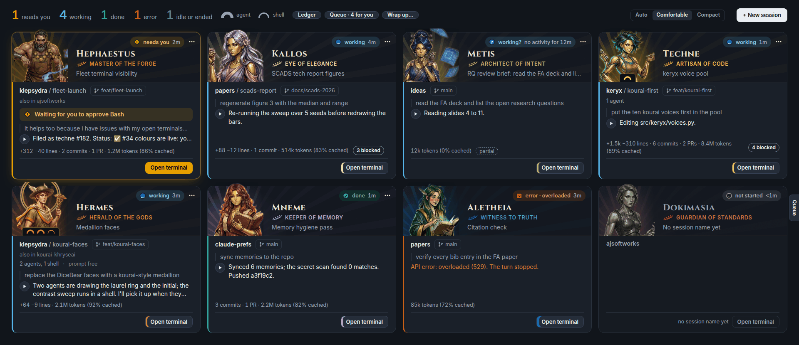
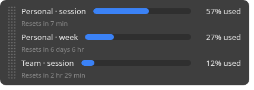
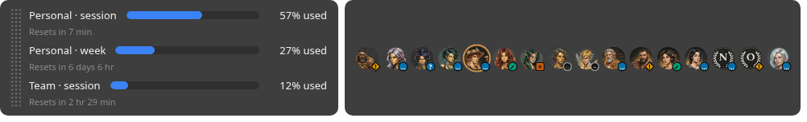
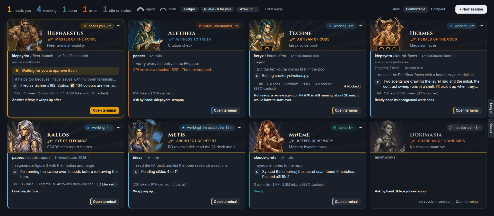
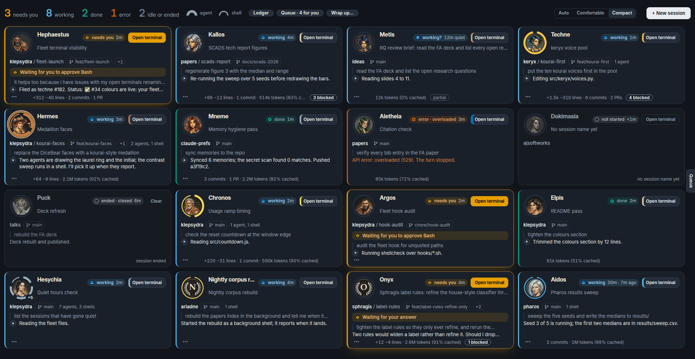
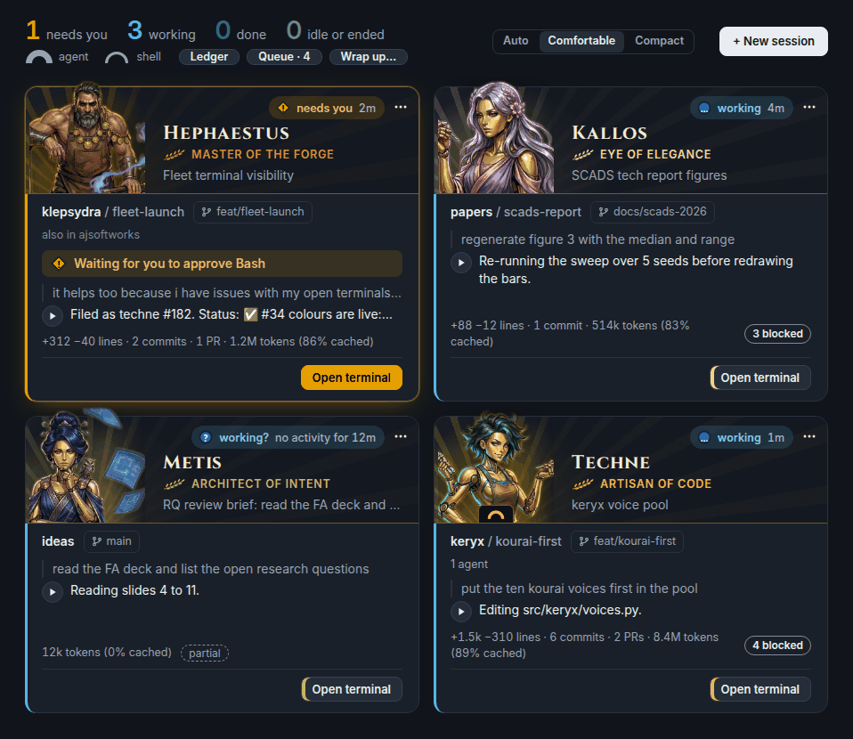
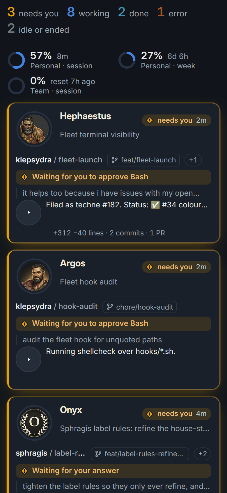
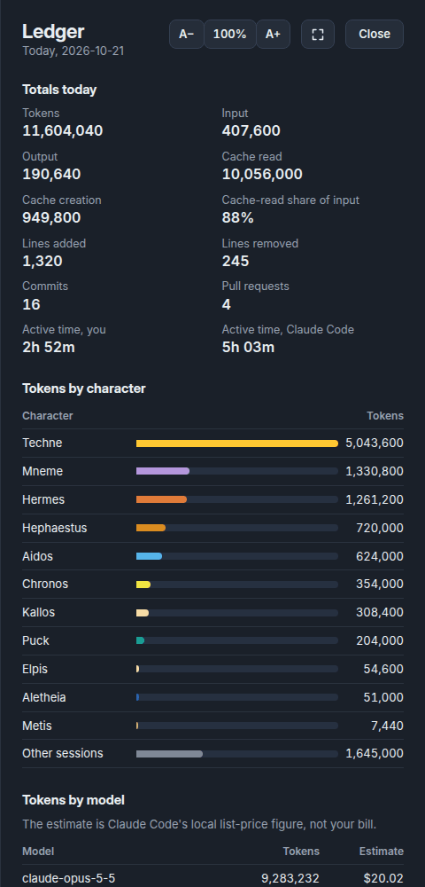
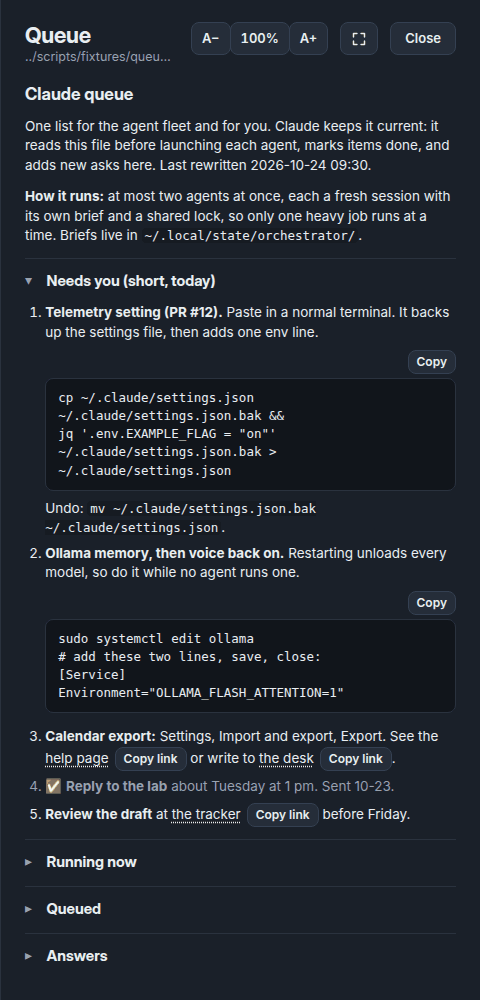

<p align="center">
  
</p>

<h1 align="center">klepsydra</h1>

<p align="center">Your Claude Code usage limit always on screen, and every session on one wall.</p>

<p align="center">
  <a href="https://github.com/ajbarea/klepsydra/actions/workflows/ci.yml"></a>
  <a href="LICENSE"></a>
  
</p>

<!-- budget: 160 words -->
klepsydra is a thin always-on-top bar for Windows and Linux that shows how
much of your Claude Code session and weekly limits you have used, so you see
it without running `/usage` in whichever terminal is in front. The bar fills
blue to yellow to red as a window is used up.

Beside the bar sits a portrait for each Claude Code session, the ones waiting
on you first. Click one to open the fleet wall: a card per session with its
status, where it works and its last exchange, and buttons to jump to its
terminal or end it. From the wall you can open the
[ledger](#the-ledger) of tokens and blocked calls, read your to-do file in the
[Queue panel](#queue-panel), [wrap up](#wrapping-up) every session before a
restart, [split](#split-mode) the screen with the fleet terminal (Windows),
and follow the wall [from your phone](#fleet-on-your-phone).

## Why "klepsydra"

A *klepsydra* is the Athenian water clock: a vessel that drains to time a
speech in court. A visible, depleting allotment.

## How it gets the number

Claude Code pipes a JSON blob to your `statusLine` command on every render.
That blob carries the same rate-limit figures `/usage` displays:

```json
"rate_limits": {
  "five_hour": { "used_percentage": 73, "resets_at": 1746540000 },
  "seven_day": { "used_percentage": 12, "resets_at": 1746799200 }
}
```

So the status line does double duty: it prints a compact readout to your
terminal, and publishes the figures to a small JSON file. The overlay polls
those files. No API calls, no credentials, no second background process.

```
Claude Code (every session)
  │ statusLine JSON on stdin
  ▼
klepsydra-statusline.sh ──► <app data dir>/accounts/<account>/<session>.json
  │                                          │
  └─► "Opus 5 · ctx 21% · 5h 73% · 7d 12%"   └──► klepsydra overlay
```

The app data dir is `%LOCALAPPDATA%\dev.ajsoftworks.klepsydra` on Windows and
`$XDG_DATA_HOME/dev.ajsoftworks.klepsydra` on Linux (`~/.local/share` when
`XDG_DATA_HOME` is unset or relative).

### Reconciling several terminals

Each session holds whatever *its own* last API response said, and Claude Code
re-runs the status line with that same response on `refreshInterval`, at a
window's reset time and on mode changes. So the hook publishes a session's
reading only for a new response (the session's API time grew, or its windows
changed), each session to its own file, stamped `observed_at`. The overlay
reconciles them per account and window:

- the reading observed last is current, because it came from the latest API
  response;
- readings observed in the same second fall back to the later `resets_at`,
  then the higher number.

Files without `observed_at` come from an older hook, which restamped every
session on every re-render. Observed readings newer than all of them make
them obsolete, and they are ignored. Until then, or while one is newer than
every observed reading (an old hook still writing), the overlay takes the
newest window and its highest reading, as before. Upgrade the hook with the
overlay.

Taking the highest reading is not safe even within one window: a reset granted
mid-week or a plan upgrade lowers usage under the same `resets_at`.

### Old readings

A reading whose every window has ended is never published, since a real
response always reports the window it counts against. Once an hour, in the
background, the hook deletes readings the overlay can never draw again: a
session's file whose every window ended over a day ago, unless it is its
account's newest, and that one too once the overlay drops the account after
30 days without a reading. An account with an older hook's files keeps every
reading until it is dropped, since the overlay weighs all of them there.
Anything it cannot read stays. A reading rewritten while the prune decides
stays too, and one rewritten in the instant before the delete comes back on
its session's next render. An account takes its name from its newest
reading.

## Two accounts at once

The statusLine payload carries no account identity, so the hook reads it from
the global config, which `CLAUDE_CONFIG_DIR` relocates per login:

```bash
CLAUDE_CONFIG_DIR=~/.claude-rit claude        # one account
claude                                         # the other
```

Each account publishes to its own file, so terminals on different logins never
overwrite each other, and the overlay draws a labelled row for each:

<p align="center">
  
</p>

With one account the rows drop the prefix and read "Current session" and "This
week". A separate config dir is a separate *everything* though: settings,
plugins, skills and session history. `fleet accounts sync` makes the second
folder behave like `~/.claude` and never touches either login; the installed
fleet (`make install-fleet`) re-runs it whenever `~/.claude`'s settings or
plugin lists change, and hourly. It copies `settings.json` and the plugin
lists, links `CLAUDE.md`, agents, commands, hooks, skills and `projects/` (so a
session resumes on either account), and copies only the shared keys of
`.claude.json` (MCP servers, folder trust, onboarding), never its account.

Log the second account in once, from a shell:

```bash
CLAUDE_CONFIG_DIR=~/.claude-rit claude auth login
```

The order of `FLEET_ACCOUNTS` is the workers' preference: the fleet starts each
agent on the first account with room (RIT, `~/.claude`, by default) and, when an
agent hits a limit with over 15 minutes to wait, moves it to a fresh session on
the other account if that one has room, carrying anything typed at the limited
pane. Once the preferred account has half its five-hour window free again, each
moved agent goes back at its next finished turn, never mid-turn. A worker that
keeps background work past its turns (a job watcher, a CI monitor) is asked,
once that account has had room for 5 minutes, to save, stop it and reply with
`READY-TO-MOVE` alone on the first line, and moves on that reply; a turn after
that reply (a task notification) voids it, and it is asked again each hour.
Heph is never asked. A worker whose
account has used 95% of a window (`FLEET_PREMOVE_PCT`) moves at its next
finished turn too, before the limit can stop it mid-turn. Moves run side by
side (two at a time), each launch has 120 seconds, and a failed move at a limit
or before it is tried again at the next pass, then every 15 minutes. `fleet accounts` shows
each folder's account and room; `fleet doctor` checks both are logged in and in
step. The orchestrator (Heph) is looked after too: at a limit he is resumed at
the reset, or moved to the other account as a fresh session from `HEPH.md` when
that one has room. His own account order is the workers' reversed
(`FLEET_HEPH_ACCOUNTS`, Personal first), so worker load never stalls him; he
moves back to it the same way.

## Install

**1. Publish the numbers and the sessions.** Copy the hooks, the launcher and
its tmux settings, the cast (the voice-to-colour table the hook reads until
the overlay writes the theme worn to its data dir), and
point Claude Code at the hooks. Starting sessions from
the wall needs tmux 3.3 or later (`remain-on-exit failed`); Ubuntu 24.04's 3.4
is the tested version.

```bash
cp statusline/klepsydra-statusline.sh hooks/klepsydra-fleet.sh hooks/klepsydra-launch.sh hooks/klepsydra-tmux.conf ~/.claude/
cp src/fleet/themes/kourai.json ~/.claude/klepsydra-cast.json
chmod +x ~/.claude/klepsydra-statusline.sh ~/.claude/klepsydra-fleet.sh ~/.claude/klepsydra-launch.sh
```

Then merge this into `~/.claude/settings.json` (into each config dir's
`settings.json` if you run two logins):

<!-- fleet-settings:start -->
```json
{
  "statusLine": {
    "type": "command",
    "command": "~/.claude/klepsydra-statusline.sh",
    "refreshInterval": 30
  },
  "hooks": {
    "SessionStart": [{ "hooks": [{ "type": "command", "command": "~/.claude/klepsydra-fleet.sh", "async": true }] }],
    "UserPromptSubmit": [{ "hooks": [{ "type": "command", "command": "~/.claude/klepsydra-fleet.sh", "async": true }] }],
    "PermissionRequest": [{ "hooks": [{ "type": "command", "command": "~/.claude/klepsydra-fleet.sh", "async": true }] }],
    "PreToolUse": [{ "matcher": "AskUserQuestion|ExitPlanMode", "hooks": [{ "type": "command", "command": "~/.claude/klepsydra-fleet.sh", "async": true }] }],
    "Notification": [{ "matcher": "elicitation_dialog|elicitation_url_dialog|idle_prompt", "hooks": [{ "type": "command", "command": "~/.claude/klepsydra-fleet.sh", "async": true }] }],
    "PostToolUse": [{ "hooks": [{ "type": "command", "command": "~/.claude/klepsydra-fleet.sh", "async": true }] }],
    "PostToolUseFailure": [{ "hooks": [{ "type": "command", "command": "~/.claude/klepsydra-fleet.sh", "async": true }] }],
    "SubagentStart": [{ "hooks": [{ "type": "command", "command": "~/.claude/klepsydra-fleet.sh", "async": true }] }],
    "SubagentStop": [{ "hooks": [{ "type": "command", "command": "~/.claude/klepsydra-fleet.sh", "async": true }] }],
    "Stop": [{ "hooks": [{ "type": "command", "command": "~/.claude/klepsydra-fleet.sh", "async": true }] }],
    "StopFailure": [{ "hooks": [{ "type": "command", "command": "~/.claude/klepsydra-fleet.sh", "async": true }] }],
    "SessionEnd": [{ "hooks": [{ "type": "command", "command": "~/.claude/klepsydra-fleet.sh", "async": true }] }]
  }
}
```
<!-- fleet-settings:end -->

Every fleet hook is `async`, so Claude Code never waits for it, and none
prints anything, so the permission hook never answers a prompt. The
`Notification` matcher catches an MCP server's request for input (a dialog or
a URL) and the idle notice that corrects a session still marked as working
after its turn ended. `PostToolUseFailure` ends a wait whose approved command
then failed. `SubagentStart` and `SubagentStop`, with background `Bash` calls
seen at `PostToolUse` (started in the background, or moved there at their
timeout or by hand), keep each session's background work: a turn that ends
with subagents or background shells still running stays working. A subagent
whose start was missed is picked up from its own tool events.
For the gauge alone, keep `statusLine` and leave out `hooks`.

For Wrap up (see [Wrapping up](#wrapping-up)), also copy its script and its
skill, and register the script as a second `Stop` hook. Unlike the fleet
hook it is not `async`: Claude Code reads what it prints, which is nothing
unless the wall has asked for a wrap-up and this session has not yet been
asked.

```bash
cp hooks/klepsydra-wrapup.sh ~/.claude/ && chmod +x ~/.claude/klepsydra-wrapup.sh
mkdir -p ~/.claude/skills/klepsydra-wrapup
cp hooks/klepsydra-wrapup.md ~/.claude/skills/klepsydra-wrapup/SKILL.md
```

A second Claude Code config folder (another `CLAUDE_CONFIG_DIR`) needs the
skill too, at `skills/klepsydra-wrapup/SKILL.md` inside it: a typed
`/klepsydra-wrapup` and the Stop hook both read it from the session's own
config folder. The script stays in `~/.claude`.

<!-- wrapup-settings:start -->
```json
{
  "hooks": {
    "Stop": [{ "hooks": [{ "type": "command", "command": "~/.claude/klepsydra-wrapup.sh", "timeout": 10 }] }]
  }
}
```
<!-- wrapup-settings:end -->

Merging it adds a second entry to the `Stop` list above; keep both.

For the ledger (see [The ledger](#the-ledger)), also merge this `env` block
into the user-scope `~/.claude/settings.json`. Claude Code reads these
settings only from user scope, not from a repository's settings:

```json
{
  "env": {
    "CLAUDE_CODE_ENABLE_TELEMETRY": "1",
    "OTEL_METRICS_EXPORTER": "otlp",
    "OTEL_LOGS_EXPORTER": "otlp",
    "OTEL_EXPORTER_OTLP_PROTOCOL": "http/json",
    "OTEL_EXPORTER_OTLP_ENDPOINT": "http://127.0.0.1:4318",
    "OTEL_METRIC_EXPORT_INTERVAL": "15000",
    "OTEL_EXPORTER_OTLP_METRICS_TEMPORALITY_PREFERENCE": "cumulative"
  }
}
```

Cumulative temporality makes each export carry the session's running total.
The first export after the overlay reopens then restores what the session sent
while it was closed; only a session that starts and ends while the overlay is
closed is lost. Tokens restored after a gap are counted on the day they
arrive. Claude Code reads these settings at startup, so a session started
before the change keeps its delta exports until it restarts
([Grafana](https://grafana.com/docs/grafana-cloud/monitor-infrastructure/integrations/integration-reference/integration-claude-code),
[Last9](https://last9.io/docs/integrations/claude-code/)).

Leave `OTEL_LOG_USER_PROMPTS` and `OTEL_LOG_TOOL_DETAILS` unset, so prompts and
tool arguments stay redacted.

The hook picks the overlay's data dir for the platform it runs on: on Linux,
the XDG data dir; under WSL, the Windows side, since the overlay there is a
Windows app.

Set `KLEPSYDRA_DIR` if your Windows user differs from your WSL user. It
configures both hook scripts, which want a WSL path (`/mnt/c/...`); the overlay
reads the same setting as a Windows path (`C:\...`), so exporting one value
to both sides gives the overlay a path it cannot resolve. The hooks prune
their old files only when the last folder of that path is
`dev.ajsoftworks.klepsydra`; any other name leaves them in place.

A second copy of the overlay, run to test a build beside the installed one,
takes its own `KLEPSYDRA_DIR` and `KLEPSYDRA_NO_AUTOSTART` set to any
value but empty (`1`, say; `0` holds it too). The login entry
is one per app name, so without the second setting the copy re-registers it
with its own path, and the next login starts the copy. With it set, the copy
leaves the entry alone and its tray's start-at-login item is greyed out.

**2. Build the overlay.** Windows and Linux differ here; see the Linux
section below. On Windows it requires Rust (MSVC toolchain), Node, and the
Microsoft C++ Build Tools:

```powershell
winget install Rustlang.Rustup OpenJS.NodeJS
winget install Microsoft.VisualStudio.2022.BuildTools --override `
  "--quiet --wait --norestart --add Microsoft.VisualStudio.Workload.VCTools --includeRecommended"
```

```bash
bash scripts/build-windows.sh
```

`KLEPSYDRA_STAGE=klepsydra-build-<name>` builds in a staging folder of its own,
so a branch can build beside the main one.

**3. Start it with Windows.** Put a shortcut to `klepsydra.exe` in
`shell:startup`.

Published readings live in `%LOCALAPPDATA%\dev.ajsoftworks.klepsydra`, so
uninstalling with *Delete application data* ticked takes them with it. Leaving
it unticked keeps them for a reinstall; they are rewritten within seconds of
the next Claude Code render by any terminal signed into that account.

### Linux

Tested on Debian 13 with XFCE on X11. Install Rust with
[rustup](https://rustup.rs), then the WebKitGTK, tray and build packages:

```bash
sudo apt install libwebkit2gtk-4.1-dev build-essential curl wget file libxdo-dev \
  libssl-dev libayatana-appindicator3-dev librsvg2-dev nodejs npm
bash scripts/build-linux.sh
sudo apt install ./src-tauri/target/release/bundle/deb/klepsydra_0.1.0_amd64.deb
```

Run `klepsydra` once. It registers itself in `~/.config/autostart`, so it starts
with every later login.

The tray icon needs a StatusNotifierItem host. On XFCE that is the Status Tray
panel plugin (`xfce4-panel --add=systray`). Stock GNOME has none and needs an
AppIndicator extension. Without a host the gauge still runs, but the tray menu,
and with it Quit, is unreachable: `pkill klepsydra` stops it.

Tauri's X11 click-through leaves one input pixel at the window's top-left
corner, which sits in the panel's transparent rounded corner.

The gauge needs an X11 session. A Wayland compositor shows clients no global
pointer, so under Wayland the drag handle stays inert.

`sudo apt remove klepsydra` leaves the published readings in the data dir; they
are small, and rewritten on the next render.

**Upgrading from a build older than this one:** step 1 again. The hook is a
copy in your `~/.claude`, so an upgraded overlay meets a hook still publishing
to the previous location, `%LOCALAPPDATA%\klepsydra`. The overlay reads both, so
the gauge keeps working either way; once the hook is re-copied, that folder
holds nothing current and can be deleted. Re-copy `klepsydra-cast.json` too: a
cast from before the character colours has no accents, so the buttons would
lack markers while their tmux windows stay plain. The same holds whenever the cast
grows: a voice missing from the installed copy gets no window colour. A fleet
hook from before Ping counts no turns, so its sessions get the done chime by
an older rule that can also chime when a session is resumed or a turn is
interrupted.

## Using it

Grab the dotted handle on the left edge to drag the gauge anywhere; it
remembers where you put it. Everything except that handle and the fleet
strip is click-through, so the gauge never intercepts a click meant for the
window underneath.

Scroll on the handle to resize the whole gauge, text and bars together, from
75% to 236% in 10% steps; the new size shows briefly and is remembered,
for each layout apart. The point under the pointer stays put, so the handle
stays under it. When rows come or go, the gauge grows away from the screen
edges it sits nearest: parked over the taskbar, it grows upward. Either way it
stays wholly on its monitor. Scrolling relies on Windows' "Scroll inactive
windows when I hover over them", which is on by default.

Dragging is handled in the backend rather than by `data-tauri-drag-region`,
which needs a focused window -- this one is deliberately unfocused and
click-through, so webview drag events never arrive. The pointer watcher reads
the mouse button straight from the OS instead, and a drag only begins on a
press that starts on the handle.

Neither Windows nor Tauri's X11 backend offers per-region hit testing for a
click-through window -- ignoring cursor events is all or nothing. So a
background thread watches the pointer and makes the window interactive only
while it is over the handle or the fleet strip. The frontend reports both
rectangles rather than the backend hard-coding them, so restyling cannot
desync the two.

The tray icon is itself a miniature of the bar, redrawn as the reading changes,
so the level stays readable when the overlay is covered or a fullscreen app is
in front. "Set home here" saves where the gauge sits now, and "Reset position"
returns it there, keeping the corner nearest the screen edges: a gauge homed
on the taskbar returns to the taskbar at any size. Its monitor is found by
position, then by name, then by nearness, and a changed resolution moves
home to the same relative spot. With no home saved, it goes over the primary
monitor's taskbar, 220px in from the right. The menu also toggles "Compact"
(below), "Ping" (Windows only; see the fleet strip) and "Start with Windows"
("Start at login" on Linux), and quits.
Autostart is on by default; the icon may start in the notification-area
overflow.

### Compact

"Compact" in the tray menu redraws the gauge to fit inside the taskbar. Each
window becomes a ring, filled clockwise from 12 o'clock in the bar's colours,
beside its percentage and countdown over its label, all in one row with the
fleet strip beside it. Countdowns shorten ("4h 58m", "3d 11h"), and a
reading more than 15 minutes old still says how old it is ("2h · 20m old").

<p align="center">
  
</p>

Each layout keeps its own size from the handle, since compact is sized to the
taskbar and the bars to the desk. Compact opens at 100%, where three windows
stand 42px tall against 142px for the bars, and it fits inside a 48px taskbar
up to 110%. The choice is remembered, and switching keeps the gauge on the
screen edges it sits nearest, so a gauge on the taskbar stays there.

### Staying in front of the taskbar

The taskbar is itself a topmost window, and within that band z-order goes to
whichever window was raised last -- so clicking the taskbar buries a gauge
sitting over it, and takes the drag handle out of reach. Tauri's
`set_always_on_top` diffs against the flag it already holds and does nothing,
so klepsydra calls `SetWindowPos` with `HWND_TOPMOST` twice a second instead.
`NOMOVE`/`NOSIZE` preserve your position and `NOACTIVATE` keeps focus where it
was.

On Linux the gauge sets `_NET_WM_STATE_ABOVE` and the window manager keeps it
there, so no re-assert runs. On XFCE it stays above the panel when the panel
is revealed.

## The fleet strip

<p align="center">
  
</p>

With several Claude Code sessions open, klepsydra shows a portrait for each to
the right of the gauge, with a badge for its status. Each badge has its own
shape, symbol and colour, from the Okabe-Ito palette:

| Badge | Status | Means |
|---|---|---|
| orange diamond `!` | needs you | a permission, a question, a plan or an MCP server's request is waiting |
| vermillion square `×` | error | the last turn ended on an API error |
| blue circle `…` | working | a prompt is being answered, or the turn ended with subagents or background shells still running (the prompt is free meanwhile) |
| blue circle `?` | working? | working, but nothing has happened for 10 minutes; the turn may have been interrupted |
| orange diamond `?` | needs you? | waiting on you with no word for 30 minutes; the session may be gone |
| green circle `✓` | done | the last turn finished |
| grey ring `○` | not started | no prompt yet |
| grey ring `?` | silent | no heartbeat and no event for 90 seconds; the session may be gone (never shown for a session waiting on you, since an open prompt hides the status line and stops the heartbeat) |
| grey ring `–` | ended | the session ended; it leaves after 10 minutes |
| grey ring `–` | ended · gone | the session's Claude process is gone (a reboot or `wsl --shutdown`); it leaves after 10 minutes |

On a card, an ended or error pill names its reason: "ended · exited",
"ended · gone", "error · rate limit".

A piece of background work stops counting once the hook has not heard of it
for an hour: each tool call a subagent makes renews it, while a background
shell's only word is its start. A session whose turn ended with nothing but
such stale work out reads done, so a forgotten dev server cannot keep a card
working forever.
A subagent that runs in the foreground dies with an interrupted turn, which
runs neither Stop nor SubagentStop; the idle notice that follows drops every
subagent not seen to launch in the background, so such a turn still reads done.

Sessions that need you come first, the longest wait leading, then errors,
work in progress, finished work, and the rest. A session that starts needing
you pulses once, unless the system asks for reduced motion. Every status
shows its age, in the portrait's tooltip and on its card. A ring around each
badge keeps it at 3:1 contrast against the strip's backdrop.

Click a portrait to open the card wall at that session. It is an ordinary
window, made on the first click and only hidden after that. A summary bar
counts the sessions that need you, work, are done, and are idle or ended, with
an error count only when one exists. Each card shows:

- the session's face in a ring showing its background crew: one solid arc per
  piece of work, agents first, clockwise from 12 o'clock, in the character's
  colour (gold for a medallion). A subagent's arc is thick and a background
  shell's or other task's thin, so the kind rests on width, not colour. Arcs
  are kept apart by a fixed 14 px gap (11 px on a compact card), a lone arc
  keeps its gap at 12 o'clock, at most five show with "+N" beside the ring for
  the rest (a shell keeps at least one), and the ring is plain with none out.
  While any card has work out, a key beside the tally draws the two arcs,
  "agent" and "shell"; on a narrow wall it takes a second line under the tally;
- a status pill, top right, with the badge, label and age, and the reason on
  an ended or error card;
- under where it works, what is out ("2 agents, 1 shell, 1 task") and, once the turn
  has ended with that work still running, "prompt free": the session takes a
  new prompt meanwhile;
- the session's name, where it works now (repo, worktree, branch chip: the
  repo of its last edit, else its folder's, and its folder's again once that
  worktree is removed; one line, cut short with all of it on hover, wrapped
  instead on the phone wall) and the other repos it touched: up to four by
  name, then a "+N" chip naming the rest on hover;
- for a session that needs you, a line saying what it waits for, on one
  line with all of it on hover; cut short, it loses its middle, so the tool's
  own name stays in view ("approve mcp__plugin_pl…browser_navigate");
- the last prompt on one line in a quoted block and the reply on two under
  it, one while the card asks or shows an error (hover either for all of
  it); an error takes two lines, with all of it on hover; a play
  button beside the reply when keryx kept that reply's audio (keryx's
  `reply_clips`, on by default). It plays the session's latest spoken reply on
  this machine, one card at a time; press it again to stop. keryx writes the
  clip to `replies/<session id>.wav` beside the fleet folder;
- "updated 7m ago" beside **Open terminal** once the card's newest field is
  over five minutes old.

A left edge in the status tone marks each card, and a needs-you card adds an
amber border. Ended, silent and not-started cards are dimmer. The grid uses
columns at least 420 px wide: four at 1920 px, two at 1280, one at 800.

While keryx plays a line, the speaking session's portrait shows it. keryx
writes `speaking.json` into the fleet folder for each sentence (its
`docs/speaking-signal.md` is the contract), and the overlay gives it to the
card whose Claude process (pid and start time) is keryx's; failing that, the
card with keryx's session id; failing that, the one live card wearing its
voice. Gold waves ripple outside the crew ring, paced by the line's loudness.
A gap between sentences shorter than 600 ms keeps them up, and a line cut off
stops them at once. The wall's live region says "Hermes speaking" once per
line, not per sentence; under reduced motion a still gold ring shows instead,
and on the strip the portrait wears a gold ring. A file whose line has ended,
whose version is not 1, or that starts more than 5 seconds ahead shows
nothing, so a crashed keryx leaves no waves behind. A read that fails or
catches a half-written file keeps the line it replaces until that line's end
and the 600 ms hold; only a removed file stops the waves early.

**Open terminal** (Jump) brings the session's terminal to the front. For a
session started with **+ New session**, it finds the session's tmux window by
pane id and checks the Claude process is still in that pane, selects the
window, then selects the Windows Terminal tab titled exactly "klepsydra
sessions", the fixed title of the fleet tab; a hand-opened session of that name,
whose title starts with a status glyph, is not it. If the pane now holds
another session, or a Jump of that card is still running, the card says so
and no tab is selected. If no tab matches, the window is still selected and the card
says "Selected the session's tmux window."; hidden tabs, two matching tabs and
a UI Automation failure are reported as they are. If Windows keeps the focus,
the tab's taskbar button flashes instead. A session in tmux opens this way
before it has a name.

When Open terminal is off, its reason ("session ended", "no session name
yet") shows as small text beside it.

For a tab opened by hand, Jump selects the tab whose title, after its status
glyph, is exactly the session's name. With no such tab, or more than one, it
says so and does nothing. When Windows Terminal hides its tabs (full screen or
focus mode), it says that instead. A tab renamed in Windows Terminal (Rename
tab) keeps that name and ignores Claude Code's title, so Jump cannot find it.
Rename the tab by hand to exactly the session's name (right-click the tab,
Rename tab), or start the session from **+ New session**, which needs no tab
title.

**Clear** on an ended or silent card removes it now. A session that is still
running brings its card back at its next event, without its start time or the
repos it touched.

With no session running, Hesychia, Keeper of Quiet, holds the wall in place of
the cards: "All quiet.", a line on what will appear, and **Start a session in
DIR**, which starts a session as **+ New session** does, answers in the same
note beside **+**, and names `launch_dir` when a launch there would run
(otherwise it reads **Start a session**; the folder is read again whenever the
wall window comes back). While one start runs, the other is off. When only ended cards remain, the same view shows with **Clear N
ended sessions** beside the button. Clicking a strip portrait of an ended
session shows the ended cards instead, until a session starts or they are all
cleared. It fades in, and appears at once under reduced motion.

### Ending a session

A session that runs in klepsydra's tmux (the socket `klepsydra`) and has a
known `claude` shows a three-dot button, named "Session actions for" the
character, away from Open terminal and Clear: at the top right of a
comfortable card, in the bottom-left corner of a compact one. Its menu opens
inside the card. The menu offers **Interrupt**, while the
card reads working, and **End session…**. Interrupt sends Esc to the session's pane
and asks nothing. **End session…** opens a dialog that names the character
and the repo, with Cancel focused, so Enter right after it opens cancels.
Its **End** button wakes a second after the dialog opens, so a double-click
cannot reach it. **End** the character, and the card reads "Ending Hephaestus
in 5 s" with an **Undo** button. Only when the five seconds run out does klepsydra type
`/exit` into the pane. A click or a key never ends a session on its own, and a
card that disappears, or leaves klepsydra's tmux, cancels its pending end.

One known limit: with Claude Code's vim editor mode on, the prompt may not
read `/exit` the way klepsydra expects, so Enter is not pressed and the card
says so; end such a session from its own terminal.

The card refuses, with the reason, whenever Jump would (no pane recorded, a
pane that is gone or now hosts another process), and in these cases too. The
session is outside klepsydra's tmux, so its pane is not ours to type into.
Another End or Interrupt of it is still running. The prompt did not read
exactly `/exit`, so Enter was not pressed and the line was cleared. Or the
session is still running a few seconds after `/exit` was sent.

### Wrapping up

<!-- budget: 320 words -->
<p align="center">
  
</p>

**Wrap up…**, beside Ledger, asks the live sessions to checkpoint, record
what still runs, commit their handoff and report whether stopping is safe. A dialog lists who
is asked and how, with Cancel focused, and only those sessions are asked.
Idle sessions in klepsydra's tmux, including one idle with background work
out, are marked asked, then have `/klepsydra-wrapup` typed together. A
working one is asked by the Stop hook when its turn ends; one that needs
you, once you answer and its turn ends. Ask any other by hand: type
`/klepsydra-wrapup` in its terminal. A failed typing is named in its card's note.
The dialog closes if a session arrives or changes how it would be
asked; starting over while a wrap-up still asks clears the answers so far,
though a session mid-checkpoint stays asked.

Each card then reads **Wrapping up…**, **Ready**, or **Not ready** with the
session's reason. A ready answer counts only once the turn that gave it has
ended (**Finishing its turn** until then), never while its background work
runs, and not after another turn starts (then: ask again).
After 10 minutes silence reads **No answer**, though a session already asked
may still answer while the wall shows it. A later session reads **Not
asked**. The bar counts "4 of 6 ready" over the cards that have not ended,
and **Safe to restart** appears only when every one is ready, or once every
session has ended (the bar then reads "Every session has ended"). **Stop
wrap-up** stops the asking; answers stay on the wall for an hour.

Once every card is ready, **End all ready sessions…** names each session it
will end, with Cancel focused. Its button wakes a second after it opens, and
it closes if any card stops being ready. Confirming starts each card's own
5 s End with Undo; a session that stops being ready meanwhile is not ended,
and its note says so. The dialog counts ready sessions outside
klepsydra's tmux, which you end yourself.

### Card density

The control beside **+ New session** picks the card density: **Auto** (the
default), **Comfortable** or **Compact**. Comfortable is the wall at the top of this page:
four fit the wall in split mode (2x2, about 945 to 958x1000 of content) and
eight fit it maximised (4x2, about 1920x1000) with no scrollbar, as the
browser test measures them: every card waiting on you to approve a long
MCP tool, or every card ending on a long API error, each with a long session
name, place and branch, twelve other repos, a crew, a long prompt and reply,
a two-line receipt and "updated". A wrap-up line or a long note under a
button can still make a forced Comfortable wall scroll; Auto turns compact
then.
Compact keeps three short rows: the header, with a 56 px portrait (crew ring
and speaking waves included), the name and session name, the pill and a
smaller **Open terminal**; one line for where it works, the crew and a "+N" chip
for the other repos it touched (hover it for their names); and the exchange,
the prompt on one line and the reply on two. "updated 7m ago" joins the
pill's time ("30m · 7m ago"), and Clear sits beside Open terminal and takes
its place when it is off. A line at the foot of each compact card is kept for
a button's note, or the reason Open terminal is off, so neither covers the
card's text; a note cut short shows in full on hover. An off button's name
carries its reason for screen readers too.
Eight compact cards fit the wall snapped to half a 1920x1080 screen (about
945x1000 of content) and sixteen fit it maximised (about 1920x1000).

Auto turns compact as soon as the comfortable cards would scroll, measured on
an unseen comfortable copy of the wall and its bar whenever the wall changes
size (a card arriving, leaving or growing) and when the window is resized. It turns back only once the comfortable cards would
still fit with one more card, so a session ending and another starting at the
boundary leaves the wall as it is. The choice is saved as `wall_density` in
`prefs.json`.

<p align="center">
  
</p>

### Split mode

<p align="center">
  
</p>

On Windows, **Split** (beside **Ledger**; its full name is "Split with
terminal") puts the wall on the
left half of its monitor and the `fleet` Windows Terminal window (the one
holding the "klepsydra sessions" tab) on the right half. The halves are of
the work area, so the taskbar stays clear. The windows' visible edges meet
on the split line, and the terminal is stacked right under the wall so no
other window covers its half. The fleet tab is selected in it. A maximized
or minimized window is first shown at its normal size without taking the
focus; a terminal maximized and then minimized comes back at its normal size
on the right, not maximized.
Pressing it again turns split off and puts both windows back where they were,
maximized if they were; a window closed meanwhile is skipped. The toggle is
pressed only once a split has landed. If the fleet terminal is not open, the
note says so and nothing moves; **+ New session** opens it.

While split is on, klepsydra watches both windows. As soon as either one
leaves its half (dragged or resized by more than 4 px, maximized, minimized
or closed, the wall's close included), Split turns itself off and saves off,
and its note names the window and how it left. Both windows stay where you
put them; one press on **Split** snaps them back. The split's own moves, and
half a second of settling after them, never count. The watcher is a
`SetWinEventHook` on the two windows' threads, served by a thread of its
own, so the wall's UI thread does not wake for it.

The other way round, while split is off: snap the wall into the left half
and the fleet terminal into the right half of one monitor yourself (Windows
11 snapping, Snap Layouts or dragging, within 8 px), and once both have sat
still for a second Split checks itself and saves on, moving nothing. A
reversed or uneven snap does not count, nor a layout already in place when
split went off. Turning it off then leaves both windows where they are.

Split is off by default. Turning it on saves `wall_split` in `prefs.json`,
and the wall splits again the first time it opens after klepsydra starts. Where the windows sat before is
kept in memory only: after klepsydra restarts, turning split off leaves both
windows where they are. Jump in split mode switches the tmux window on the
right and moves neither window. The toggle is hidden on Linux. A Windows
Terminal window set to stay on top loses that when split, and turning split
off does not set it again.

### Starting sessions

**+ New session**, in the wall's summary bar, starts `claude` in `launch_dir`
as a window of the tmux session `fleet` on the socket `klepsydra`. The first
click opens a Windows Terminal window named `fleet` with one tab. Each later
click adds a tmux window to that tab. Closing the tab leaves the sessions
running, and the next **+** or Jump reattaches. The tab attaches to the tmux
server by its socket path.

On a cold WSL the tab can take longer than the 5 seconds the launcher waits
for it. The note then says "Started a session in DIR. The terminal tab has not
attached yet.", and for 30 seconds another **+** or Jump opens no second tab.
A click waits up to 45 seconds for WSL. Past that the note says "WSL did not
answer within 45 seconds. The session may still be starting; check the
terminal before clicking again." A Jump waits 15 seconds, past the 10 seconds a
failing WSL interop call takes to report, then says "WSL did not answer within
15 seconds. The window may still come forward; if it does not, try again." A
slow Jump holds only its own card: other cards' Jumps and **+ New session**
still run. A Jump that has to open the terminal tab waits up to 10 seconds for
another click opening one, then says so. Each `wsl.exe` call adds a line to
the [log](#logs) with its verb, its session, how long it took and its outcome.

`launch_dir` and `launch_distro` are keys in `prefs.json`, in the app data dir.
`launch_dir` defaults to `~`. `launch_distro` defaults to WSL's default
distro. tmux loads `~/.claude/klepsydra-tmux.conf`, which turns on focus
events so Claude Code can track terminal focus, then `~/.tmux.conf`, which can
turn them back off. The klepsydra file then names each window after its Claude
session and keeps a window open when `claude` exits with an error. This is the
one place the overlay starts a process: `wsl.exe`, from a click, one call at a
time.

Each kourai character's canon colour marks its session twice: its window in
the tmux status bar and a 4 px left marker on its card's **Open terminal**
button (6 px for the two accents, Aletheia and Dokimasia, that fall under 3:1 on the button at rest or on hover), so the
gold marker leads to the gold window. The fleet hook sets the window's colours
(`window-status-style`, and `window-status-current-style` with black or white
text, whichever reads better) at the session's start, whenever its keryx
voice changes and at its first event after a theme switch, only on the
`klepsydra` socket, from the theme worn (`<app data dir>/cast.json`, else
`~/.claude/klepsydra-cast.json`). The button is neutral by default, so emphasis
follows urgency and not whichever character a session got. The one filled
button is on a card that needs you (also the quiet "needs you?"): amber, black
text at 9:1, no marker. A session whose voice is no character gets the plain
neutral button and tmux's default colour; a disabled button has neither fill
nor marker. The status tones (card edge, pill, badges) stay status-only.
Windows Terminal tabs opened by hand are not coloured.

To see the wall without sessions, serve the repo root (for example
`python3 -m http.server`) and open `/src/wall.html?demo`; `?demo=8` shows
its first eight sessions, `?demo&empty` the empty wall, `?demo&ended` the
wall with only an ended card, and `&theme=professions` or `&theme=dicebear`
another character theme.

A session's face follows its keryx voice, so it stays the same while the
session moves between repos. Sixteen voices, all fourteen in keryx's rotation pool,
`af_nicole` (keryx's fifteenth, before any blend) and Athena's `bf_alice`, are cast
as characters and show their portraits: ten from kourai-khryseai and six (Chronos,
Argos, Hermes, Elpis, Hesychia, Athena) painted for this app. The orchestrator wears Hephaestus or
Athena (`bf_alice`, outside keryx's pool), equals, one per session: a new
orchestrator session takes the one no other orchestrator card on the wall
wears (a live one first), keeps it, and a `/clear` passes it on. With both
shown it is the one seen least recently; on a tie or with neither, the one
`~/.local/state/fleet-orchestrator/orchestrator.face` names (`athena`, else
Hephaestus). No worker ever wears either.
Any other voice shows the voice's name
and a forge medallion: a laurel ring on a dark disc around the name's
initial, struck in one of six kourai metals (gold, bronze, copper, rose gold,
pale gold, verdigris) picked by the voice, so two voices with one initial
usually differ. A session without keryx is named by its session, else its
folder, and its metal is picked by its session id.

While keryx is muted (`/keryx off`) it holds no new terminal, so a session
takes the voice keryx remembers for a repo and the cast stays on screen: the
repo it starts in at first, then, once it edits files in a repo keryx knows,
that repo's. So agents launched from one folder read as the repos they work
in. Changing folder alone never changes the voice, and a voice keryx holds
for the terminal always wins.

Sessions sharing a voice show its face by claim: a session that has not ended
before one that has, then a voice keryx held before a repo's, then the first
started. The others show a medallion and their own name until the keeper leaves;
two running sessions that keryx itself gave one voice both keep it. So a held
face changes with the status only once, when its session ends beside a running
one with the same voice (after `/clear`, the new session keeps the portrait). A
session on a repo's voice also changes face when an edit takes it to another
repo's.

On a Comfortable card the character arrives in a header band. Their cut-out
half-figure stands on the band's foot and breaks the card's top edge, lit from
behind in their colour: a glow and rays over a dark, grained stage. Beside it
sits the nameplate: the name in classical capitals (Cinzel, bundled under the
SIL Open Font License), their epithet ("Master of the Forge") in their colour
with a laurel sprig, then the task; the status pill rides the corner. Only 15%
of the light reaches past the figure, so the band's text keeps 4.5:1 in every
light a card can wear. A test checks each character's own light, the needs-you
amber, and a quiet card's dim light. A card that needs you is lit amber; a quiet or
ended one dims its light and greys its figure. On a figure the crew ring would
cross the face, so its arcs ride a plinth at the figure's foot instead, the
same thick and thin arcs in the same order, and the speaking waves rise behind
the head. A medallion keeps its round portrait and ring on the band. A new
card's figure steps in and its light rises, once, unless the system asks for
reduced motion. Compact keeps the round portrait (64 px) and its ring.

Click a character's figure (in Compact, their face), or press Enter or Space
on it, to open their whole portrait with their name, epithet and voice.
Escape, Close or a click outside closes it, and focus goes back to the figure,
or to the wall if the card has left.

The portraits are files in `src/fleet/faces`, each listed in `LICENSES.json`,
and `scripts/cut-portraits.py` cuts them: ten from kourai-khryseai, five from
`assets/portraits/`. Each character has a round face at 96 and 192 px, a
half-figure (`-figure.webp`) and the whole portrait (`-full.webp`). The five
newer figures are cut from their painted backdrops by `scripts/cutout-portraits.py`
(rembg's `isnet-anime` model, Apache-2.0), run once; its output is committed. The medallion is
an SVG drawn in `src/fleet/medallion.js`. The overlay loads no library and
fetches nothing.

### Voices

The tray's **Voices** menu says who speaks through keryx: **Heph only** (the
default), **Everyone** or **Off**. It is kept in `prefs.json` (`"voices"`),
where `fleet/launch.sh` reads it, so it applies to each session launch.sh
starts from then on: a relaunch, a move to the other account, `fleet recover`.
A session keeps its mode through `/clear`, and one started from the tray's
Start is not covered. Heph only starts workers with keryx off
(`KERYX_ENABLED=false` in `fleet/worker-settings.json`), so a worker loads no
summarizer or voice model; Everyone starts them without that line; Off also
starts Heph with keryx off, through `--settings`, which outranks the user's and
the project's settings.

### Character themes

The cast wears one of three themes, all full and equal, chosen in the tray's
**Characters** menu or the wall's Characters picker over its density choice.
The choice is kept in `prefs.json` (`"theme"`) and applies at once, without a
restart: every card's name, epithet, face and colour (Comfortable and
Compact), the strip beside the gauge, an open portrait, the Ledger's
names, the Queue's keeper, the empty wall's keeper, the phone wall and the
tray's tick. The wall names the theme on `<html data-theme="...">`, as a CSS
colour theme does; each card's colour is its own `--accent`.

- **Kourai** (the default): the kourai portraits above.
- **Professions**: plain roles a newcomer reads at once (Foreman, Engineer,
  Architect, Inspector, Reviewer, Archivist, Researcher, Librarian, and so
  on), each a role glyph on a disc in its colour, with a line of what they
  do ("Writes the Code").
- **DiceBear**: the Lorelei avatars klepsydra wore before the portraits, as a
  cast of their own (Max, "Runs the Show"; Ivy, "Ships the Code"; Luna,
  "Keeps the Peace").

Each theme is one data file, `src/fleet/themes/<id>.json`, shaped like the
others and keyed by the same keryx voice ids; a page loads Kourai's with
itself and another the first time it is worn, so a voice is one character in
every theme and the speaking waves and which session keeps a face never
change. A test holds every theme to every voice. Only Kourai has
half-figures, so in the other two a card keeps its round face on the band
and the portrait button opens the face drawn large. The empty wall's keeper
is each theme's `af_nicole` (Hesychia, the Librarian, Luna). Picking with
the arrow keys wears each theme at once and saves only where the picker
rests.

Each theme has its own colour per voice; Kourai keeps kourai's canon. The
Professions and DiceBear colours are 15 OKLCH hues 24 degrees apart over
three lightness steps (0.66, 0.78, 0.90), so neighbours differ in lightness
as well as hue, which a colour-blind eye still sees. Tests hold each colour
to 3:1 or more on the card, the plinth and the button at rest and on hover
(WCAG 2.2, 1.4.11), each name, task and epithet on the band to 4.5:1 under
every light (1.4.3), every pair apart in OKLab by 0.08 or more, and by
0.015 or more as seen with protanopia, deuteranopia or tritanopia (Machado,
Oliveira and Fernandes 2009); the closest is DiceBear's 0.016 under
deuteranopia. Kourai's canon colours are kept as they are, though their
nearest pair under tritanopia is 0.014, under that bar. A colour never
carries a character alone: the name and face do (1.4.1).

The tmux windows take the theme's colours too. The overlay writes the theme
worn to `<app data dir>/cast.json` at start and on every switch; the fleet
hook reads it before `~/.claude/klepsydra-cast.json`, and a session's window
takes the new colour at its next hook event.

The Professions and DiceBear faces are WebP files rendered once by
`scripts/render-themes.sh` and committed, each with its `LICENSES.json`
entry; the app calls no avatar service. The script installs
`lucide-static@1.55.0`, `@dicebear/core@9.4.3` and `@dicebear/lorelei@9.4.3`,
and everything they pull in, from the lockfile in `scripts/render-themes/`.

Credits: the Professions glyphs are from [Lucide](https://lucide.dev)
(ISC licence, Copyright (c) Lucide Icons and Contributors), except the
Guide's compass, the Researcher's magnifier and the Timekeeper's clock,
which Lucide derives from [Feather](https://feathericons.com) (MIT licence,
Copyright (c) 2013-present Cole Bemis). Both licences ship beside the faces
in `src/fleet/faces/professions/LICENSE-lucide.txt`. The DiceBear
faces are [DiceBear](https://www.dicebear.com)'s Lorelei style, a remix of
[Lorelei](https://www.dicebear.com/styles/lorelei/) by Lisa Wischofsky,
released under CC0 1.0 (no attribution required; credited here anyway);
the DiceBear library is MIT. Licences per style:
[dicebear.com/licenses](https://www.dicebear.com/licenses/).

The fleet hook writes `<app data dir>/fleet/<session>.json`: the state, where
the session works, the first 300 characters of your last prompt and of the
last reply, how many turns have ended, and the error text of a failed turn. It
records no tool input beyond the tool's name and an edited file's path. The status line adds
`<session>.beat`, the session's name, at most once per 10 seconds. At a
session start, at most once an hour, the hook deletes a session's file when
its Claude Code process is gone and its newest time field (including
`written_at`) is more than a day old, along with the session's beat file. A
session with a fresh heartbeat survives, whatever its file says. A
beat file with no session file, and leftover temp files, go when their own
modification time is more than a day old.

The overlay starts no process and asks WSL for nothing: it watches the folder
and re-reads it every 5 seconds. A file it cannot read is skipped and logged
once to the [log](#logs), and the rest of the fleet still shows.

### Ping

With "Ping" ticked in the tray menu, klepsydra plays a short chime when a
session needs you or finishes its turn: two notes at one pitch when it needs
you (a prompt, a question or an error), two rising notes when a turn ends.
Ping is off until you tick it, and ticking it plays the needs-you chime once.
Several sessions changing together make one chime, needs-you first. Within 2
seconds of a chime only a needs-you after a done plays, so a burst makes one
sound and a prompt still gets its own. A chime answers a hook event, as the
hook wrote it: nothing plays for what was already on the strip when
klepsydra started, a session coming back from silence, or a resume. Done
plays at each Stop, so a turn that another Stop hook sends back to work
chimes at each of its Stops.

The chime stays silent while Do Not Disturb or a Focus session is on, or
while a full-screen app, a game or presentation mode is in front. Windows
reports Do Not Disturb only through an undocumented setting, so if klepsydra
cannot read it, the chime plays. Ping is Windows only; the Linux tray menu
has no "Ping".

The chimes are built by `scripts/make-sounds.mjs`, which writes
`src-tauri/sounds/`; the tests fail if the files and the script disagree.

### Fleet on your phone

<!-- budget: 560 words -->
With "Phone wall" ticked in the tray menu, klepsydra serves a read-only copy
of the wall on `127.0.0.1:8318`, and Tailscale Serve carries it to your phone
over your tailnet. Unticked (the default), nothing listens.

1. Tick **Phone wall** in klepsydra's tray menu. The box stays ticked across
   restarts; if the port is taken it stays clear and the [log](#logs) says why.
2. Install Tailscale on the PC and on the iPhone, signed in to the same
   tailnet.
3. In the Tailscale admin console, under DNS, enable **HTTPS certificates**
   (MagicDNS too, if it is off).
4. On the PC, in a terminal: `tailscale serve --bg 8318`. To stop serving:
   `tailscale serve --https=443 off`.
5. On the iPhone, open `https://<device>.<tailnet>.ts.net` in Safari, then
   Share, **Add to Home Screen**. It opens as an app from then on.

Never use `tailscale funnel` for this: Funnel puts the wall on the open
internet. The server refuses any request Funnel forwards, and any request
whose Host is not loopback or a `*.ts.net` name.

On the phone the wall is one column of compact cards, needs-you first, under
a tally that stays at the top. It updates as the desktop's does, over one
event stream. Nothing on it acts on a session: every session action and the
ledger stay on the desktop, though a wrap-up's answers and readiness count
show. Touch has no hover, so a card that cuts text short shows **Full text**,
which unfolds it in place and asks the server nothing. A card's play button
plays its latest spoken reply on the phone. A session with Remote Control on
(`/remote-control` in its terminal) shows **Open in Claude**, and a tap on its
card opens that session on claude.ai or in the Claude app. The link appears at
the session's next hook event after Remote Control connects, survives
`/clear`, and goes when it disconnects or the session ends. When the stream
drops, the wall says the cards may be out of date until it reconnects, and
keeps trying while klepsydra restarts.

The usage-limit gauges open the page: a ring per account and window with
its percent, time to reset and label (`57% 8m Personal · session`), drawn by
the gauge's own code from the same readings, read every 5 seconds. They
scroll away under the tally, and say so while no reading exists. The wall
stays dark when the phone is in light mode.

<p align="center">
  
</p>

The server answers only GET and HEAD, serves only the wall's own files, its
snapshot at `/fleet.json`, the stream at `/events` and the reply clips of the
cards it shows. It sends each session without its tmux pane, process or full
folder path, and each usage reading with only its label, times and session,
week and spend windows, its account as `a1`, `a2`. Card previews (prompts
and replies), the spoken replies, errors and the cost estimate are visible to any tailnet device your Tailscale ACLs
let reach this PC. The page's service worker keeps only the page and its
files, never the fleet or a clip.

The Home Screen icons are drawn by `scripts/make-phone-icons.py` from the
mark in `src-tauri/icons/`.

### The ledger

<p align="center">
  
</p>

With the `env` block above, every Claude Code session sends its
OpenTelemetry metrics and events to klepsydra, which counts them per session:
tokens by type, lines added and removed, commits and pull requests, active
time (yours and the CLI's), edit accepts and rejects, tool results and
failures, API errors and refusals, and the tool calls a hook or a permission
rule turned down. Each of those turn-downs is also logged with its time,
session, tool and source. Rejections you make yourself are counted
separately.

- **Local only.** The receiver listens on `127.0.0.1:4318` and nowhere else.
  Under WSL with mirrored networking, WSL's `127.0.0.1` is the Windows host,
  so sessions in WSL reach the Windows overlay. Nothing leaves the machine.
  It answers only requests addressed to `127.0.0.1:4318` or `localhost:4318`
  that carry no `Origin` header, so a web page cannot post to it by
  rebinding a domain name to `127.0.0.1`. Claude Code's exporter sends no
  `Origin`.
- **Content stays redacted.** Claude Code replaces prompt and response text
  with `<REDACTED>` unless `OTEL_LOG_USER_PROMPTS` is set, and sends no tool
  arguments unless `OTEL_LOG_TOOL_DETAILS` is set. The exports still carry
  your account email and organization ID as attributes; klepsydra does not
  store them.
- **Cost is an estimate.** Claude Code's `cost.usage` is its local list-price
  estimate: it works the figure out on your machine from token counts at
  standard list rates, so it can differ from your bill. On a Pro or Max plan
  it is not money spent. The ledger stores it as `cost_usd_estimate_micros`,
  and the Console usage page or claude.ai usage settings are the billing
  record ([Claude Code costs](https://code.claude.com/docs/en/costs)).
- **Tokens by model.** Each day file keeps, per session, the four token types
  and the cost estimate for every `model` the session used (`models`), at most
  16 per session; the rest are added under `(other)`. The drawer's "Tokens by
  model" table sums them over the sessions it shows.
- **Where it is kept.** One file per local calendar day in `ledger/` under
  the app data dir, such as `ledger/2026-10-20.json`, written whole each time.
  Files more than 30 local days old are deleted. `ledger/state.json` holds each session's running
  totals and what stops a retried export from counting twice. An unreadable
  `state.json` is set aside as `state.json.bad`, new baselines start, and the
  time before is recorded as a gap. A session already in a day file only sets
  its baseline with its next cumulative export, so its running total does not
  count twice. Its new series (a resumed process, a new model) also count only
  from their next export, so that session can read low; it reads partial.
- **When the overlay is off.** Claude Code's exports fail quietly and the
  session carries on; that stretch is not counted. If something else holds
  port 4318, klepsydra logs it to the [log](#logs) and exposes it in the fleet
  view as `receiver`, and the drawer shows it. It runs without
  the ledger and tries the port again every 30 seconds.
- **Partial sessions.** While the receiver listens, the overlay stamps
  `ledger/alive` with the time every 60 seconds. When the receiver next starts
  listening, the time since the last stamp (everything before it, on the first
  run ever) is recorded as a gap in `ledger/state.json` (at most 64, kept 30
  days). A session that was alive during a gap wears a dashed "partial" mark
  on its receipt: some of its telemetry was not received because klepsydra was
  not running for part of it. A session whose running total moved on in a
  cumulative export received after the gap ended, with the setting above, was
  restored and wears no mark; a retried export from before the gap does not
  count. The mark says nothing about a session that was merely idle. It also
  misses one case: a session resumed in a new process (the same session id)
  after its earlier process ended while klepsydra was closed. The new process
  restores only its own total, so the earlier process's last tokens are lost
  and the session does not read partial.
- **Checking the ledger against the transcripts.** `ledger-verify` sets a
  day's ledger against the usage Claude Code writes to its own transcripts
  (`~/.claude*/projects/*/<session>.jsonl` and `<session>/subagents/*.jsonl`;
  the largest `message.usage` per message id, counted on the local day of its
  timestamp). It prints, per session, the ledger and transcript counts of each
  token type with the percent difference, and exits 1 when a session the
  ledger has is more than 2% lower on `cache_read` or `cache_creation`, which
  means exports were lost ("lost exports", reason "ledger lower"). A session
  with transcript usage and no ledger entry whose every message lies within
  two minutes of a gap in `state.json` lost every export: it is listed under
  "lost exports" with the reason "receiver down" and also exits 1. One with
  no ledger entry and a message outside every gap never exported, as when it
  started without the telemetry settings; it is listed under "sent no
  telemetry (started without the telemetry settings)" and does not set the
  exit code. The last line gives
  both counts, and an unreadable `state.json` exits 2. A ledger that is
  higher is expected (it also sees calls that never reach a transcript, such
  as side calls on smaller models) and is only reported. Restored tokens count
  on the day they arrive, so after a gap that crosses midnight the earlier day
  can read low, and exit 1, with nothing lost. From WSL:

  ```bash
  cd src-tauri && cargo run -q -p klepsydra-fleet --bin ledger-verify -- \
    --ledger /mnt/c/Users/$USER/AppData/Local/dev.ajsoftworks.klepsydra/ledger \
    --day 2026-10-21
  ```

  `--projects DIR` (repeatable) replaces the default of every
  `~/.claude*/projects`, and `--tz ZONE` the machine's time zone. It runs on a
  recorded fixture in `cargo test -p klepsydra-fleet`.

On the wall, each card with something to count has a receipt line, such as
`+312 −40 lines · 2 commits · 1 PR · 1.2M tokens (86% cached)`, which is
hidden while everything is zero; a compact card shows its three most telling
parts. A chip such as "3 blocked" counts the tool calls a hook or a
permission rule turned down in that session, and opens the drawer for it. The
**Ledger** button in the header opens the drawer for every session: today's
totals, tokens per character (by the voice in each session's own fleet file
when it was first seen, or the voice that later replaces a repo's home voice
as on the card, written to the day file at once, so a character keeps its
tokens after its card is cleared and sessions sharing a held voice all count
for it; a session on a repo's home voice keeps a row of its own, named for its
card, and the day file keeps that name once the card is gone; every session with no cast character is one "Other sessions" row,
whose tooltip counts the sessions with no voice and those whose voice is
outside the cast), tokens by skill, plugin and MCP server, the
tokens by model, the list of blocked tool calls (each named by the same
character), API errors and refusals, and
one dim line with the cost as Claude Code's local list-price estimate. Every chart has a table beside it. Claude
Code redacts third-party plugin and skill names, and MCP servers you
configured, so the drawer labels those "third-party" and "custom". The
drawer is local and reads only today's file.

The drawer is a side panel built the same way as the [Queue panel](#queue-panel), and it
behaves the same way. It docks on the right at 1200 px and wider and is a
dialog when the window is narrower. It can be shut to a **Ledger** tab or
filled to the whole window. It takes the same drags, the same separator keys
and the same text size controls, and it remembers its own width, view and
text size. Those are kept apart from the Queue's. A chip opens it docked on
that card's session, a chip pressed while it is open turns it to that
session, and Close or Esc gives focus back to the chip, while the **Ledger**
button that shuts it keeps the focus. While it is open, new snapshots from
the fleet make it read the ledger again, at most once every 5 seconds.

### Queue panel

The **Queue** button beside **Ledger** shows your to-do file inside the wall,
in a side panel the Ledger shares (`src/fleet/sidepanel.js`):
by default `claude-queue.md` on your Desktop (the Desktop known folder, so a
redirected Desktop is found too). The file stays the source of truth: agents
and you keep editing it with any editor, and the panel only reads it.

To read another file, pick it with the tray's **Choose queue file...**, or
let a session own it: an orchestrator that keeps the queue runs

```bash
bash ~/.claude/klepsydra-fleet.sh queue set ~/fleet/queue.md --by "Hermes (orchestrator)"
```

and the panel names the file and says who keeps it ("Kept by Hermes
(orchestrator)"), the way Claude Code's own to-do list is Claude's to edit and
yours to read. `queue show` prints the current choice and `queue clear` goes
back to the default. Both write `queue.json` in klepsydra's data folder (under
WSL the path goes across as a Windows one), the newest choice wins, and it
applies within five seconds. `--by` takes a name of 1 to 80 characters,
always shown as typed. Without `--by`, from a session keryx holds a voice
for, the hook names the keeper itself (the voice's character in the theme
worn, "kept by Hephaestus"), and the panel renames it when the theme
changes. A
file kept inside WSL (`\\wsl.localhost\...`) sends Windows no change
notices, so its edits show on the five-second re-read rather than at once;
one on a Windows drive (`/mnt/c/...`) shows within a second or two. An older `queue_path` in `prefs.json` still
works when there is no `queue.json`.

<p align="center">
  
</p>

- **Live.** klepsydra watches the file's folder and re-reads the file a
  quarter second after a burst of writes ends (at most a second after the
  first), and every five seconds besides, so an agent's edit shows within a
  second or two.
- **Shut, docked or full.** At 1200 px wide and more the panel docks on the
  right and the cards make room; narrower, it opens as a dialog over the
  wall, as the Ledger does. Drag its left edge, or focus that edge and use the
  arrow keys (Home and End for the narrowest and widest), to resize it.
  Drag the edge right past half the narrowest width (160 px from the window's
  edge) and the panel snaps shut; drag it left to within 350 px of the
  window's left edge (half the 700 px it leaves the cards) and it fills the
  window. Either snap shows while you hold the drag, and dragging back over
  the line undoes it, as VS Code's panels and macOS split views do.
- **The tab.** Shut, the panel leaves a small **Queue** tab at the middle of
  the right edge, in the wall's margin. Click it, or press **Ctrl+Alt+B**
  anywhere (the shortcut VS Code uses for its right-hand side bar), to open
  the panel again at its last width; Ctrl+Alt+B shuts it too. **Close**, Esc
  and the **Queue** button shut it to the tab as well. Below 1200 px there
  is no margin to spare, so a shut panel shows no tab and the **Queue**
  button opens it.
- **One panel at a time.** The Queue and the Ledger share the right edge.
  Opening one, docked or full, shuts the other, the way Chrome's side panel
  and VS Code's side bar show one view at a time. While both are shut their
  tabs sit one above the other, Ledger over Queue, so either is one click
  away. While one is open neither tab shows, and the header buttons switch
  between them. Each panel keeps its own width, view and text size
  (`klepsydra.queue.*` and `klepsydra.ledger.*` in the page's storage).
  Ctrl+Alt+B opens the Queue over an open Ledger, docked, full or a dialog,
  and shuts the Ledger. The Ledger has no shortcut of its own.
- **Full screen.** The **Full screen** button in the panel's header (beside
  Close) fills the window, keeping the text-size controls; Esc, the same
  button, or a drag of the left edge back to the right returns it to docked.
  Below 1200 px the button widens the dialog to the whole window, and Esc
  steps back to the dialog.
- **From the keyboard.** On the focused edge, Enter shuts the panel and moves
  focus to its tab, where Enter or Space opens it again. Home at the
  narrowest width shuts it, End at the widest fills the window. In full,
  Enter docks it at its width, Home at the narrowest, and the Right arrow or
  Page Down at the widest.
- **Remembered.** The width and whether the panel is shut, docked or full
  are kept across restarts. A window under 1200 px starts with it shut (a
  dialog at launch would hide the wall), without forgetting the choice.
- **Text size.** **A−** and **A+** in the panel's header make its text
  smaller or larger, from 75% to 200%, and the percentage between them resets
  it to 100%. While the panel is open, Ctrl+= and Ctrl+- do the same, Ctrl+0
  resets, and Ctrl with the mouse wheel over the panel steps it a notch at a
  time. Only the panel's text changes, never the cards, and the size is
  remembered.
- **The header count.** The button reads "Queue · 3 for you": the items in
  the file's "Needs you" section, less those marked ✅. It names the file's
  asks, not the sessions the tally counts as needing you.
- **Reading aids.** Each `##` section folds, with Needs you open. Lines
  starting with ✅ read quieter, as done; 📋 lines carry a pending mark.
  Every code block has a **Copy** button.
- **Text only.** The file is parsed with a pinned copy of markdown-it and
  built into the page as text. Raw HTML shows as text. A link shows its text,
  with the address on hover and a **Copy link** button: klepsydra starts no
  program but the launcher, so it does not open links itself. Only `https:`,
  `http:` and `mailto:` links get the button; any other link is plain text.
- **Empty until written.** A path with no file yet shows an empty queue
  naming the path, not an error; it fills in when an agent writes the file.
- **One line when it cannot.** A folder, link or pipe at the path, a file
  over 256 KB, or one that is not UTF-8 text is not read, and the panel says
  which. So does a `queue.json` or `prefs.json` that cannot be read (rather
  than falling back to the Desktop file), and a file that cannot be shown.

## How often it refreshes

The status line is event-driven: Claude Code runs it as you work, and the hook
publishes whenever a render carries a new reading. `refreshInterval: 30` also
re-runs it every 30 seconds, idle or not. The usage reading ignores those
re-runs, since each repeats the session's last API response, but each writes
the session's heartbeat for the fleet strip, at most once per 10 seconds. The
overlay re-reads the files every 5 seconds (the phone wall's server too), and
the countdown ticks every 15 seconds off `resets_at`, so it stays right even
when nothing is publishing.

## Switching accounts

A running session moves to a new login at its next request, so its next reading
publishes under the new account. A re-render before then repeats the old
account's reading, which stays filed under the old account.

The account you switched away from keeps its rows, since they tell you whether
switching back would help. A window that has reset reads `0% used` with when it
reset. An account's rows go only after 30 days without a reading.

Rows are ordered by when each account last published, so the account you are
signed into now leads and the one you switched away from sits under it. The
tray icon follows the same order, and so tracks the account you are on.

## Restyling

Every visual token lives at the top of `src/style.css`: bar height (10px, read
from across a desk) and radius, the three ramp colours and their thresholds,
panel background, padding and width, fonts and sizes. Each size is multiplied
by the zoom set from the handle. `--ramp-mode` picks between `blend` (continuous
interpolation) and `bands` (flat colours that switch at thresholds). Edit,
rebuild, done.

The fleet strip's sizes and the compact layout's ring sit in the same block,
followed by the few tokens the compact layout changes. The strip's badge colours are in
`src/fleet/badge.css`, where a test holds each to 3:1 contrast, and the card
wall's tokens open `src/fleet/wall.css`, with a copy of the ramp for the
phone's gauges that a test holds equal to this one.

## When it does not know

A gauge showing a confident wrong number is worse than one admitting
ignorance, so every reading says how old it is once that matters:

| Condition | Shown |
|---|---|
| No file yet | `waiting for Claude Code`, panel dimmed |
| Reading older than 15 minutes | number kept, `updated 2 hr ago` after the countdown |
| The window's own reset time has passed | `0% used`, `Reset 2 hr ago` |
| Unreadable or malformed file | skipped; the account's other sessions still count |

Readings are per machine. Usage on another machine, or since a window reset,
shows up here only once a terminal on this machine makes a request.

`rate_limits` is absent before the first API response of a session and when no
window is active. The hook treats that as "nothing to say" and leaves the
previous file alone rather than overwriting it with blanks.

## CI watch

<!-- budget: 300 words -->
`fleet/ci_watch.py` watches GitHub Actions on every active repo in
`~/.claude/techne.toml`. It polls every 2 minutes, or longer when GitHub's
`x-poll-interval` asks, with conditional requests: an unchanged answer is a
304, which costs no rate limit. A run counts when it is on the repo's default
branch or at the head of an open pull request. The newest completed run per
workflow and branch that succeeded or failed decides (a cancelled, skipped or
neutral run decides nothing): `failure`, `timed_out` or `startup_failure` is
red, and a later green run clears it. The default branch and each open PR's
head are asked for on their own. A red run that pages out of the newest runs
stays red until a newer run of its workflow in the same place decides, its PR
closes, its workflow is deleted, or a month passes.

Each new red run gets one unattended, read-only triage by techne ci-audit's
report mode (`report.sh`, from the installed techne plugin or
`TECHNE_CI_REPORT`): the failing step, its cause and its file:line. The triage
runs on the first account with room, in the fleet's order, then on each other logged-in account
when one is at its usage limit. If any account was at its limit, the triage
waits and is tried again every 10 minutes, for up to a day, and the red is
routed once it has its cause or has waited 30 minutes. It also
gets one line under "Needs you" in the queue file. Dependabot's reds are kept
for the morning instead. Once a day (after `CI_SWEEP_HOUR`, default 6) the
latest green run on each default branch is read for warnings. The watcher
pushes, merges and re-runs nothing. No error stops it: a repo that cannot be
read is skipped for the pass and logged, and each triage is saved as soon as it
is done, so a restart triages nothing twice. Its triage folders are removed after
two weeks.

It writes `ci.json` to the app data folder, which the wall and the phone show
as a **CI** button in the bar: hidden without a CI watch, `CI ok` when every
repo is green, red with a count when a run is red, and `CI ?` when the watch
has not reported for 15 minutes. It opens a list of the red runs: repo,
workflow, branch or PR, the failing step, the triaged cause with its
file:line, and the run on GitHub: a link on the phone, its address as a
tooltip on the desktop until the app can open links (#149). On the phone the
button is a full 44 px touch target. The app reads the file capped, cuts each text to 300
characters and keeps a link only when it is a GitHub Actions run, so a
local path never reaches the phone.

The watcher logs
one JSON line per decision to `log/ci.log` in the fleet's state folder (rotated
past 1 MiB, four kept). Run it as a user service:

```bash
systemd-run --user --unit=fleet-ci-watch -p Restart=always -p RestartSec=60 -E PATH -E HOME /usr/bin/python3 -I "$PWD/fleet/ci_watch.py"
```

## Logs

<!-- budget: 340 words -->
The Rust shell and the pages (the gauge and the wall) write to one file,
`logs/klepsydra.log` in the app data dir: on Windows
`%LOCALAPPDATA%\dev.ajsoftworks.klepsydra\logs`, Tauri's log folder, and
under `KLEPSYDRA_DIR` when that is set, so a test copy keeps its own. Each
line is one JSON object: `ts` (UTC), `level`, `target` (the module that
logged, `webview::<file>` for a page), `message` (a page's error with its
stack), and `session_id` when the event is about one session. The first
line of a run names the log file and the data folder; paths in later lines
are relative to that folder, and a file of your own (the queue file) is named
by its file name alone:

```json
{"ts":"2026-10-28T15:04:05.123Z","level":"WARN","target":"klepsydra::fleet","message":"skipped fleet/0b1e5b4e-6f0e-4bbd-9d3c-2a7a1c0f9e11.json: malformed: EOF while parsing a value at line 1 column 59","session_id":"0b1e5b4e-6f0e-4bbd-9d3c-2a7a1c0f9e11"}
```

`jq 'select(.level == "ERROR")' klepsydra.log` lists the failures. Past 1 MiB
the file is renamed `klepsydra_<UTC time>.log` and a new one starts; the four
newest renamed files are kept, so the logs stay under 5 MiB. While another
program holds `klepsydra.log` open without delete sharing, that rename fails:
tauri-plugin-log 2.10.1 then holds new lines in memory, tries the rename again
with each line, and writes them all once it succeeds. A page failure that
repeats on every poll or snapshot is logged the first time, then at the 10th,
100th and 1000th. A run from a terminal also prints the same events as plain
lines on stderr.

The level is info: a call that worked, a server that started. Set
`KLEPSYDRA_LOG` to `error`, `warn`, `info`, `debug` or `trace` before starting
the app to change it; an unknown value is logged and info used. In a page,
debug lines also need localStorage's `klepsydra.debug` set to `1`. Builds
before the log moved wrote `fleet.log` in the app data dir; it can be deleted.

## Fleet engine

<!-- budget: 450 words -->
`fleet/` holds the scripts that run an orchestrated fleet of Claude Code
sessions in the `fleet` tmux session: they start agents, resume them after a
usage limit, and check the fleet's health. `make install-fleet` links each one
from this checkout into the fleet's state folder (`~/.local/state/fleet-orchestrator`,
or `FLEET_STATE`), so pulling main updates the fleet. It also links the `fleet`
command into `~/.local/bin` and writes the services as user units in
`~/.config/systemd/user`, which start again after a reboot. A copy a link
replaces goes to `archive/fleet-scripts-<date>/`. Runtime state (`panes.tsv`,
briefs, logs) stays in the state folder.

| Command | What it does |
|---|---|
| `fleet doctor` | One line per check: the resume service, its last pass, Remote Control on every registered pane and the orchestrator's, the phone wall locally and over Tailscale Serve with a fresh `fleet.json`, a pane watcher, and briefs' shared rules. Exits non-zero on any failure. `--json FILE` also writes the checks as a report, and logs only a check that changed status (a recovery without its detail). The `fleet-doctor.timer` runs it every 5 min into the data folder's `fleet-health.json`, which the wall and the phone show as a **Fleet** button beside **CI**: failing checks first, `Fleet ?` when the report is over 15 minutes old, no links and `~` for the home folder. |
| `fleet log [N]` | The last N decisions as plain lines. |
| `fleet brief NAME BODY` | Writes `task-NAME.src`: BODY, then the shared rules in `fleet/brief-tail.md`. `--check` lists briefs whose rules drifted. |
| `fleet cutover` | Restarts the resume service on the installed scripts and confirms its start is logged. |
| `fleet agora post [--kind gripe\|win\|idea\|wish\|kudos] TEXT` | Posts one line (280 characters) on the Agora, signed with the session's character, agent and repo, from inside a fleet session. Optional for agents, one post an hour each; a post that looks like it holds a secret is refused. Posts are JSON lines in `agora/posts.jsonl` in klepsydra's data folder. `fleet agora list [N]` shows the newest. |
| `fleet/launch.sh NAME BRIEF` | Starts an agent with its own session id in a memory-capped scope. It turns Remote Control on and waits for it to settle, pastes the brief, checks the brief reached the prompt, then submits it. A retry never sends Escape. It records the pane, session id and folder in `panes.tsv`. |
| `fleet/resume-at-reset.sh` | The resume service. It resumes a limited pane at the reset its banner names, or at once after a switch to an account with room; the orchestrator too, who moves to the other account as a fresh session from `HEPH.md` when that one has room. It starts a registered pane fresh from its brief after an hour idle. Whatever AJ typed at a limited pane is sent as typed; a line that left the prompt unsent is typed again. Each pane's state survives a restart of the service. |

Every script logs each decision as one JSON line in `log/fleet.log` under the
state folder, in the app log's shape (`ts`, `level`, `target`, `message`, then
the event's own fields: pane, account, reason). The file rotates past 1 MiB
and keeps four old files. `jq 'select(.level == "ERROR")'` lists failures.

## Tests

```bash
bash statusline/test_statusline.sh       # usage hook and heartbeat, against recorded payloads
bash hooks/test_fleet.sh                 # fleet hook: states, where, identity, pruning, gone, settings, window colours
bash hooks/test_launch.sh                # launcher: new, jump, tab reuse, against a private tmux socket
bash fleet/test_fleet.sh                 # fleet engine: limits, resets, typed lines, launch delivery, doctor, against fake panes
bash scripts/test_measure_memory.sh      # the release memory check
python3 -I fleet/test_ci_watch.py        # CI watch: which runs count, triage once, Dependabot, 304s
node --test src/*.test.js                # ramp, countdown, reconciliation, fleet model, faces, guards, logger
npm run lint                             # Biome: no console.log, info or debug; pages log through src/log.js
uvx ruff check                           # the Python scripts, logging rules included
(cd src-tauri && cargo test -p klepsydra-fleet)   # fleet reader, OTLP receiver, phone wall server and ledger
bash scripts/build-windows.sh --check    # clippy and every Rust test, on Windows
bash scripts/visual-check.sh             # screenshots every state, the strip and wall included
```

The app crate needs WebKitGTK headers to compile on Linux, so in WSL only the
fleet crate's tests run locally; `--check` and CI cover the rest.

## Releasing

A release ships only when all three hold:

1. Every command under Tests passes, and CI is green on both platforms.
2. The live check, in order:
   1. Back up your Claude Code settings:
      `cp ~/.claude/settings.json ~/.claude/settings.json.bak-fleet`
   2. Merge the fleet settings block from Install, the JSON between the
      `<!-- fleet-settings:start -->` and `<!-- fleet-settings:end -->`
      markers, into `~/.claude/settings.json`. It registers the fleet hooks
      with `async: true` and sets `statusLine.refreshInterval` to 30.
   3. With the new build running, open eight Claude Code sessions in Windows
      Terminal tabs and bring each to one state:
      - **not started:** start `claude` and type nothing.
      - **working:** ask for something long, such as running `sleep 300` in
        Bash.
      - **needs you, approve Bash:** in the default permission mode, ask for a
        command that prompts, and leave the prompt open.
      - **needs you, question:** ask Claude to ask you a multiple-choice
        question, and leave it open.
      - **done:** a prompt that finishes, such as "say hi".
      - **error:** a turn that ends on an API error, such as a prompt in a
        session started with `--model` naming a model the account cannot use.
      - **silent:** `kill -STOP <pid>` on one session's Claude Code process
        (the `claude.pid` in its session file). `kill -CONT <pid>` brings it
        back.
      - **ended:** `/exit` in one session. It leaves after 10 minutes.
   4. Exercise what the status rests on:
      - **Held prompts:** leave a permission prompt and a multiple-choice
        question open for 3 minutes each. Each stays needs you with its age
        growing, never silent and never done (the status line hides while a
        dialog is open, so no heartbeat arrives, and `idle_prompt` must not
        fire).
      - **Failed command:** approve a command that fails, such as
        `grep nomatch /etc/hostname`. The need clears, back to working then
        done.
      - **Subagent ask:** have a subagent ask for a permission and answer it.
        The need clears after the answer.
      - **Exits:** close one tab with its X and `/exit` another. Both read
        ended within 10 minutes, not silent.
   5. Read `bash scripts/fleet-status.sh` against the strip and the wall, one
      line per session. Its `state` column is the portrait's badge and the
      card's status; `reason` is the card's text under it (the tool for
      approve Bash, the question for a question); `beat age` over 90 seconds
      is silent, which the card shows with its age, except for a session that
      needs you: it keeps needing you while its prompt is open (step 4) and
      reads "needs you?" after 30 minutes with no word.
   6. Click each portrait: the wall opens on that session's card. Press
      **Open terminal** on the approve-Bash card: its tab comes to the
      front, or its taskbar button flashes. Rename a hand-opened session to
      another session's name and press Jump again: it says two tabs match and
      does nothing. Move the wall, quit klepsydra from the tray, start it again and
      open the wall: it opens where you left it.
   7. Starting sessions, with `klepsydra-launch.sh` and `klepsydra-tmux.conf`
      in `~/.claude/`:
      - Press **+ New session** three times: one tab, three windows.
      - Press **Open terminal** on each card: each hops to its own window.
      - Close the tab, then press **+**: the tab reattaches and adds a window.
      - Press **Clear** on an ended card: it goes.
      - With every session ended, the wall reads "All quiet." with **Clear N
        ended sessions**; press it, then **Start a session in DIR**: one
        window starts in `launch_dir`.
      - Run `wsl --shutdown` and start klepsydra and a session again: the old
        cards read "ended · gone".
   8. Restore your settings:
      `mv ~/.claude/settings.json.bak-fleet ~/.claude/settings.json`
3. Memory. Right after starting klepsydra, run
   `bash scripts/measure-memory.sh run /tmp/klepsydra-memory.log` in a WSL
   terminal and leave both running for 8 hours with the fleet in use. It
   samples klepsydra's working set in MiB, WebView2 processes included, at 5
   minutes and at 8 hours. It refuses to run with more than one klepsydra.exe,
   and the check fails if klepsydra restarted between the readings. The release
   is blocked if the second reading is more than 10% above the first. Record
   both readings in the release's ROADMAP entry.
