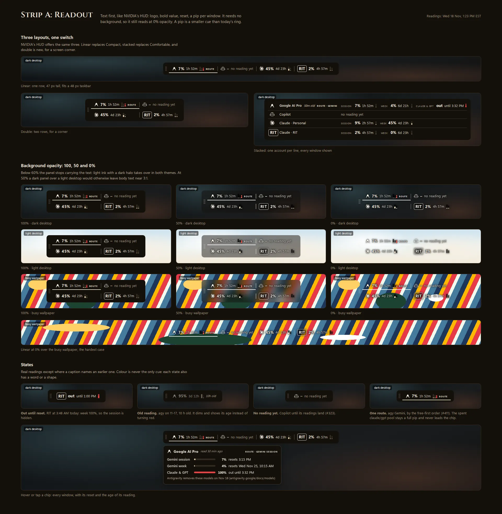
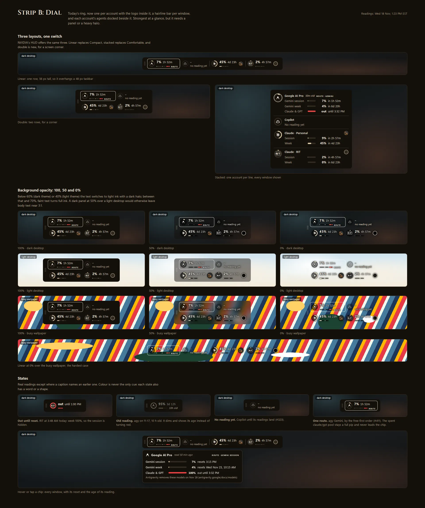
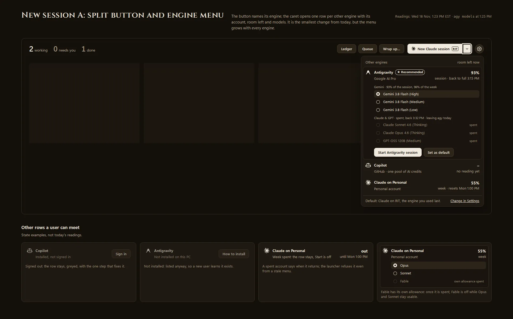
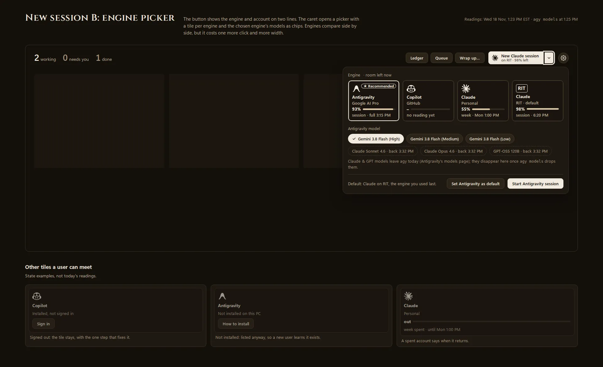
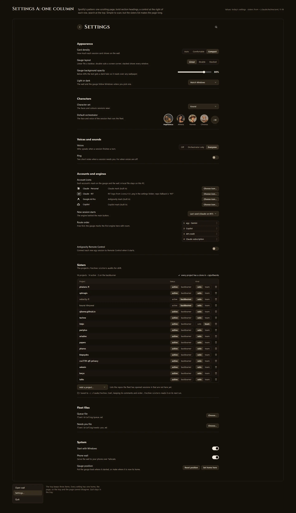
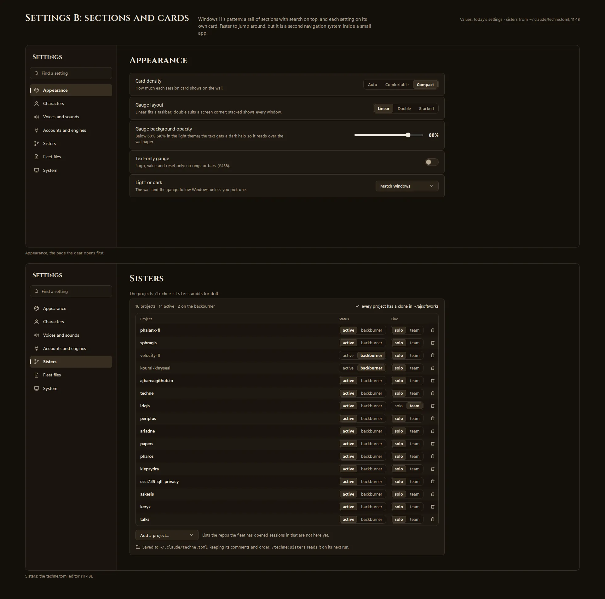

<!-- budget: 700 words -->
# klepsydra design pass, 2026-11-18

Mockups for the gauge strip (#421, #438), + New session (#440) and the settings page (#384), for you to pick from before anything is built. Every reading is the real one from 1:23 PM today. Each shot is the full page at 1920 wide; phone (390) shots sit beside them in the same folder. PR: [klepsydra#459](https://github.com/ajbarea/klepsydra/pull/459).

## Gauge strip

| A: Readout | B: Dial |
|---|---|
|  |  |
| [light](shots/design-gauge-a-1920-light.webp) · [phone dark](shots/design-gauge-a-390-dark.webp) · [phone light](shots/design-gauge-a-390-light.webp) | [light](shots/design-gauge-b-1920-light.webp) · [phone dark](shots/design-gauge-b-390-dark.webp) · [phone light](shots/design-gauge-b-390-light.webp) |
| Text first, like NVIDIA's HUD: logo, bold value, reset, one small pip per window. It reads at 0% opacity over the dark and light desktops; over a busy wallpaper the small reset times thin out. The trade: a pip is a smaller status cue than a ring. | Today's ring, one per account, with the logo inside it and each account's agents docked beside it. Strongest at a glance. The trade: its hairline bars fade once the panel goes, and at 56 px it overhangs a 48 px taskbar (A is 47 px). |

Both have the three NVIDIA layouts on one switch (linear, double, stacked), and the 100/50/0% opacity grid over dark, light and busy wallpaper. Below 60% the text switches to light ink with a dark halo, because at 50% a dark panel over a light desktop leaves body text near 3:1. Both also show the states: out until reset (session hidden), an old reading dimmed with its age, the Copilot placeholder, and one route mark (agy Gemini). Linear width with 4 chips: **671 px (A), 634 px (B)**, against about 1,700 px for today's 7 meters. Neither layout changes width between 1920 and 1366.

**Recommendation: A, with B's docked faces.** #438 makes 0% a real setting, and A reads best there. A is also the less wordy one you asked for (logo, value, time). The faces docked to their account fix the "separate avatars" problem in #421 and move over to A unchanged.

## + New session

| A: split button and menu | B: engine picker |
|---|---|
|  |  |
| [light](shots/design-new-session-a-1920-light.webp) · [phone dark](shots/design-new-session-a-390-dark.webp) · [phone light](shots/design-new-session-a-390-light.webp) | [light](shots/design-new-session-b-1920-light.webp) · [phone dark](shots/design-new-session-b-390-dark.webp) · [phone light](shots/design-new-session-b-390-light.webp) |
| "New Claude session" plus a menu row per other engine, with its account, room left, models and Recommended mark. The trade: the menu grows with each engine. | The button names engine and account; the caret opens tiles to compare engines and model chips. The trade: one more click, a 720 px picker, and the default reappears as a tile, which split-button guidance advises against. |

Both show agy's real `agy models` list, with the spent Claude & GPT group disabled and saying when it returns. Both also show the signed-out, not-installed and spent-account rows, and Claude's models with Fable's own allowance spent (Fable off, Opus and Sonnet usable).

**Recommendation: A.** It follows every split-button rule in #440: it names the default action, does not repeat the default in the menu, and keeps the button and caret separately reachable. It is also the smallest change from today.

## Settings

| A: one column | B: rail and cards |
|---|---|
|  |  |
| [light](shots/design-settings-a-1920-light.webp) · [phone dark](shots/design-settings-a-390-dark.webp) · [phone light](shots/design-settings-a-390-light.webp) | [light](shots/design-settings-b-1920-light.webp) · [phone dark](shots/design-settings-b-390-dark.webp) · [phone light](shots/design-settings-b-390-light.webp) |
| Spotify's pattern: one page, bold section headings, the control at the right, search at the top. The trade: the 16-row sisters list makes it long. | Windows 11's pattern: a section rail with search, one card per setting. The trade: a second navigation system inside a small app. |

Both hold every setting from the tray and the gear (#384's inventory), plus gauge layout, opacity and text-only mode, account icons, route order, the new-session default and the sisters editor. The editor shows the real 16 projects from `~/.claude/techne.toml` (read only), each with its status and kind; all 16 have a clone. The tray shrinks to Open wall, Settings and Quit.

**Recommendation: A**, the Spotify page you named, with the sisters list folded under a "16 projects" expander (not drawn here) so the page stays short. Seven sections fit one scroll; a rail pays off only with many more.

Sources and fidelity

- NVIDIA overlay: horizontal or vertical layouts and a dozen stats to choose from ([Guru3D](https://www.guru3d.com/story/nvidia-statistics-overlay-adds-cpu-temperature-power-and-clock-monitoring/), [TweakTown](https://www.tweaktown.com/news/101595/nvidia-app-has-officially-launched-an-essential-tool-for-geforce-rtx-users/)), plus your 11-17 layout shots.
- iStat Menus 7: stacked and dual-line label/value modes, and a combined item that keeps a summary in the bar with detail in the dropdown ([MacRumors](https://www.macrumors.com/2024/07/31/istat-menus-7-0-brings-new-features)). This is the model for the hover detail.
- Stats: per-module widget styles, including a bar chart comparing 5-hour and 7-day Claude usage ([mac-stats.com](https://mac-stats.com/), [solbish/stats](https://github.com/solbish/stats)). This is the model for the pips.
- Windows widgets: the small size is for glanceable, focused content, with at most one touch point and 4.5:1 text contrast ([Microsoft Learn](https://learn.microsoft.com/en-us/windows/apps/design/widgets/widgets-design-fundamentals)).
- Raycast menu bar: an icon with a short title, and an icon-only option ([Raycast API](https://developers.raycast.com/api-reference/user-interface/menu-bar-extra)). This is the model for logo plus value.
- Settings rows: a header, an optional description and a right-aligned control; a section heading in BodyStrong; expanders one level deep ([Microsoft Learn, app settings](https://learn.microsoft.com/en-us/windows/apps/design/app-settings/guidelines-for-app-settings)), plus your Spotify reference shot.
- Tabular figures stop numbers from jittering as they update ([MDN](https://developer.mozilla.org/docs/Web/CSS/font-variant-numeric)).
- Split button, opacity and colour rules: the sources already cited in #440, #438 and #421.
- **Fidelity:** colours and type are the app's own tokens. Shots render in Segoe UI Variable from this PC. The gauge's light theme is new: it uses the wall's parchment light tokens. The RIT chip shows the repo's "RIT" monogram; your local icon file would show the real logo. Copilot is a placeholder until #323.

