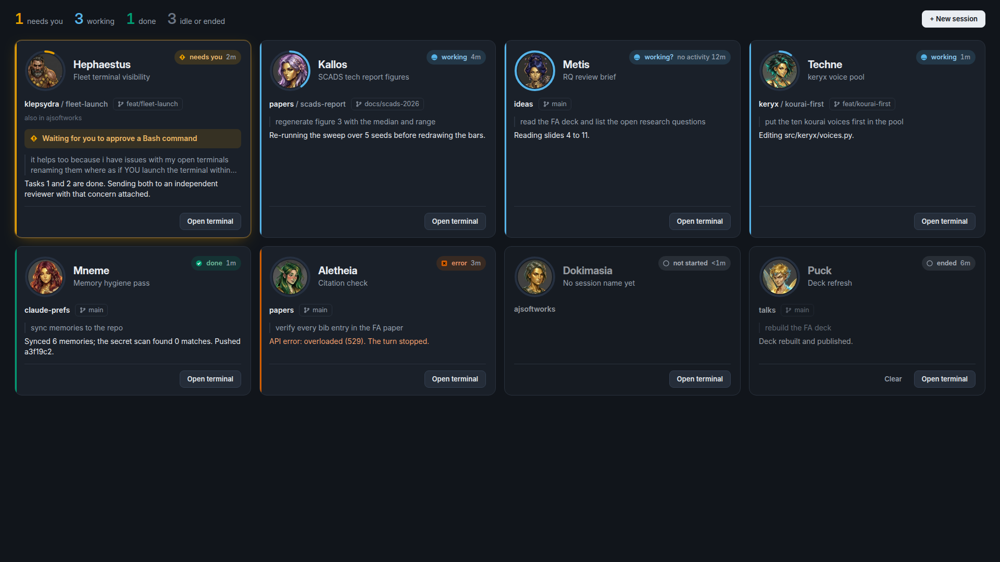

<!-- budget: 600 words -->
# Fleet wall redesign: design

Date: 2026-10-20. Status: approved by AJ 2026-10-20 from the mockup below ("I LOVE THE CARD REDESIGN").

## Goal

With four or more sessions up, one glance at the wall answers who needs AJ,
how long each has waited, and what each is doing. Live work stands out, and
idle work steps back.

## The changes

- **Water-clock arc.** Each portrait sits in a ring that fills with the time
  that turns its card "working?" or "needs you?". Working fills over 600 s
  (the reader's `QUIET_AFTER`) from `active_at`, the file's last change, which
  moves on every hook event. Needs-you fills over 1800 s
  (`WAITING_DOUBT_AFTER`) from `status_at`, when it asked. Every other
  status shows an empty track. A test reads both constants from `view.rs`,
  so the arc and the reader agree.
- **Status pill, top right.** It holds the badge, the label and the age. An
  ended or error pill names its reason: "ended · gone", "error · rate limit".
  Silent and quiet cards keep their "no word for" or "no activity for" age.
- **Ask line.** A needs-you card adds a tinted line saying what it waits for:
  "Waiting for you to approve Bash", "Waiting for your answer", "Waiting for
  you to approve the plan".
- **Tone edge.** A 3 px left edge in the status tone. A needs-you card also
  gets an amber border and glow.
- **Quiet cards dim.** New, silent and ended cards use a darker card, a
  greyed portrait, and dimmed name, place and transcript.
- **Summary bar.** Counts for needs you, working, done and idle or ended,
  with error shown only when one exists. The **+ New session** button
  (see the launch design) sits at its right.
- **Card text.** The session name is the subtitle ("No session name yet"
  until it has one). The voice name moves to the portrait's tooltip. Place
  reads `repo / worktree` with the branch in a chip and a git icon. Touched
  repos follow as "also in ...". Your prompt sits in a quoted block, and the
  reply follows in full text.
- **Actions.** "Jump to terminal" becomes **Open terminal**, the same command.
  A disabled button gives its reason as a tooltip and as small text beside
  it, apart from the result note. A result or error shows under the buttons
  for 8 s, then clears. Clear (see the launch design) is a quiet text button
  beside it.
- **Grid.** Columns of at least 420 px: four at 1920, two at 1280, one at 800;
  three start near 1365 px.

## Tokens

| Token | Value | Use |
| --- | --- | --- |
| `--wall-bg` | `#11151b` | window |
| `--card-bg` | `#1a2029` | live card |
| `--card-quiet` | `#161b22` | new, silent, ended card |
| `--card-line` | `#2a323e` | borders, track |
| `--text` / `--text-dim` / `--text-faint` | `#e9edf2` / `#98a2b0` / `#6b7584` | text |
| `--tone-working` | `#56b4e9` | arc, edge, pill (Okabe-Ito sky blue; `#0072b2` is too dark on the slate) |

Badges keep `badge.css` and its Okabe-Ito tones. The wall sets
`--badge-ring` to the card colour. Text keeps Segoe UI Variable, and names
use its Display cut.

## Unchanged

The face strip, the reader, statuses and their order, accessible names, the
live region, and the kourai faces.
